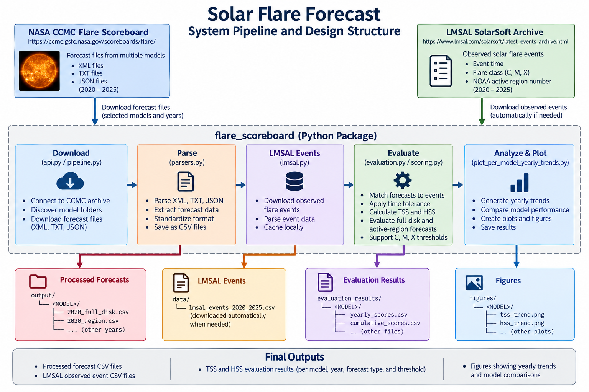

# Solar Flare Forecast

Solar Flare Forecast is an open-source Python package for retrieving, processing, and evaluating historical solar flare forecasts from the NASA Community Coordinated Modeling Center (CCMC) Flare Scoreboard.

The package provides access to forecast data through the CCMC HAPI API and historical forecast archives. Users can select forecasting models, flare classes, forecast types, and date ranges to retrieve and analyze historical predictions.

For forecast evaluation, the package compares processed archive forecasts with observed solar flare events from the LMSAL SolarSoft archive and calculates verification metrics, including the True Skill Statistic (TSS) and Heidke Skill Score (HSS).

The project supports historical solar flare forecast analysis for 2020–2025, with data availability varying by model and source. It can be installed directly from PyPI and used through Python functions or a command-line interface.

## Features

### Forecast Data Retrieval
- Retrieve historical solar flare forecasts from the NASA CCMC Flare Scoreboard.
- Access forecast data through the HAPI API and historical forecast archives.
- Select individual models, multiple models, or all available models supported by the workflow.
- Query full-disk and active-region forecasts by flare class and UTC date range.
- Automatically split long HAPI requests into intervals of up to 31 days.

### Data Processing and Storage
- Parse historical forecast files in XML, TXT, and JSON formats.
- Organize forecast records into structured CSV files for analysis.
- Filter archived forecasts by selected date ranges.
- Reuse locally cached downloads and processing checkpoints to reduce repeated work.

### Forecast Evaluation
- Retrieve observed solar flare events from the LMSAL SolarSoft archive.
- Compare processed archive forecasts against observed flare events.
- Calculate True Skill Statistic (TSS) and Heidke Skill Score (HSS).
- Evaluate C-, M-, and X-class flare thresholds when supported by the available data.
- Generate yearly and cumulative evaluation results.

### Package Accessibility
- Install the package through PyPI or directly from GitHub.
- Access package functionality through importable Python functions.
- Run forecast queries using the `solarflarecast` command-line interface.
- Export forecast data and evaluation results as CSV files.

## Installation

Solar Flare Forecast requires Python 3.10 or later. The package can be installed directly from PyPI or from the GitHub repository.

### Option 1: Install from PyPI (Recommended)

Install the published package using pip:

```bash
pip install solar-flare-forecast
```

After installation, verify that the command-line interface is available:

```bash
solarflarecast query --help
```

This displays the available commands and options for retrieving historical solar flare forecasts.

### Option 2: Install from GitHub

Clone the repository and install the package:

```bash
git clone https://github.com/kkritika123/solar-flare-forecast.git
cd solar-flare-forecast
pip install .
```

For development, install the package in editable mode:

```bash
python -m pip install -e .
```

### Verify the Installation

Run:

```bash
python -c "import flare_scoreboard; print('Solar Flare Forecast package imported successfully')"
```

The package can now be used through its Python functions and command-line interface.

## Forecast Queries

The package provides a command-line interface for querying historical solar flare forecasts from the CCMC Flare Scoreboard.

Users can select a forecasting model, forecast type, flare class, UTC date range, and data source.

### HAPI API

Download forecasts directly from HAPI:

```bash
solarflarecast query --source hapi --model NOAA_1 --type full_disk --flare M --start 2024-01-01 --end 2024-01-07
```

This query was tested and returned 18 forecast records.
Long date ranges are automatically split into requests of at most 31 days. Results are saved as CSV files in `data/hapi/`.

### Processed Archive

Query previously processed archive forecasts:

```bash
solarflarecast query --source archive --model SPS_1 --type full_disk --flare M --start 2024-01-15 --end 2024-02-10 --archive-dir output
```

This query was tested and returned 25 forecast records.
The command reads existing processed CSV files under `output/<MODEL>/` and saves selected records in `data/archive/`. It does not download missing archive files.

### Batch Queries

Query selected models:

```bash
solarflarecast query --source hapi --all --models NOAA_1 ASSA_1 --type full_disk --flare M --start 2024-01-01 --end 2024-01-07
```

Query the default batch model set:

```bash
solarflarecast query --source hapi --all --start 2024-01-01 --end 2024-01-07
```

Batch queries support multiple models, forecast types, and available flare fields.

These batch commands illustrate the supported options but have not yet been verified end to end.

The original `python query_forecasts.py` interface remains available when running from the repository.

To view available query options:

```bash
solarflarecast query --help
```

## Example Output

This section presents actual results generated by the Solar Flare Forecast package using the NASA CCMC Flare Scoreboard data. The examples demonstrate forecast retrieval, probability values, and processing multiple forecasting models.

### Example 1: HAPI Forecast Query

The following command retrieves NOAA_1 full-disk M-class solar flare forecasts for January 1–7, 2024.

```bash
solarflarecast query --source hapi --model NOAA_1 --type full_disk --flare M --start 2024-01-01 --end 2024-01-07
```

**Result:** 18 forecast records retrieved.

**Sample output (first 5 records):**

| Forecast Window Start (UTC) | Forecast Window End (UTC) | Issue Time (UTC) | M-Class Probability |
|---|---|---|---:|
| 2024-01-01 00:00 | 2024-01-02 00:00 | 2023-12-29 22:00 | 0.15 |
| 2024-01-01 00:00 | 2024-01-02 00:00 | 2023-12-30 22:00 | 0.15 |
| 2024-01-01 00:00 | 2024-01-02 00:00 | 2023-12-31 22:00 | 0.30 |
| 2024-01-02 00:00 | 2024-01-03 00:00 | 2023-12-30 22:00 | 0.15 |
| 2024-01-02 00:00 | 2024-01-03 00:00 | 2023-12-31 22:00 | 0.30 |

The probability values represent the model's predicted likelihood of an M-class solar flare during the corresponding forecast window. For example, a probability of `0.30` represents a 30% predicted likelihood.

Multiple forecasts may cover the same forecast window because they were issued at different times.

**Generated CSV file:**

```text
data/hapi/NOAA_1_full_disk_M_20240101T000000_20240107T000000.csv
```

The values above were obtained directly from the generated CSV file.

### Example 2: Processing Multiple Forecast Models

The archive processing pipeline allows researchers to select one model, multiple models, or all discovered models without modifying `config.json`.

The following command processes NOAA_1 and SPS_1 forecasts for January 1–3, 2024.

```bash
python main.py --models NOAA_1,SPS_1 --start 2024-01-01 --end 2024-01-03
```

**Actual processing results:**

| Model | Files Processed | Total Parsed Rows | Rows After Date Filtering |
|---|---:|---:|---:|
| NOAA_1 | 9,620 | 62,449 | 36 |
| SPS_1 | 2,285 | 6,855 | 6 |
| **Total** | **11,905** | **69,304** | **42** |

The archive discovery process identified 17 available model folders. Two models were selected for this example.

Forecast records are filtered using `window_begin_utc`, which represents the beginning of the prediction window. The start date is inclusive, and the end date is exclusive. Forecasts issued before the requested date range may still be included if their prediction windows begin within that range.

**Generated output files:**

```text
output/date_ranges/20240101T000000_20240103T000000/
├── NOAA_1/
│   ├── 2024_full_disk.csv
│   └── 2024_region.csv
└── SPS_1/
    └── 2024_full_disk.csv
```

These results were obtained from an actual execution of the archive processing pipeline.

The HAPI query and archive processing examples use different date-filtering criteria: HAPI queries select forecast windows, while `main.py` filters archive records by forecast issue time.

Use `--source hapi` for API batch queries.

| Option | Meaning |
|---|---|
| `--model` | One model |
| `--all` | Enable batch queries |
| `--models` | Selected models in batch mode; otherwise use the default 10 |
| `--type` | `full_disk` or `active_region`; batch mode queries both when omitted |
| `--flare` | Exact field or threshold name; batch mode queries all available fields when omitted |
| `--start`, `--end` | UTC forecast-window start range: start inclusive, end exclusive |
| `--source` | `hapi` or `archive`; default is `hapi` |
| `--archive-dir` | Processed archive folder; default is `output` |
| `--out` | Output filename for a single query |

A single-model query requires `--model` and `--flare`.
Its default type is `full_disk`.

Repeating a query replaces its data CSV. Each run saves a
separate timestamped report.

## API and Archive Comparison

Compare the same query against HAPI and processed archive data:

```bash
python test_compare.py --model NOAA_1 --type active_region --flare M --start 2024-01-01 --end 2024-01-08 --archive-dir output --out noaa_ar_m_week.csv
```

Records are matched by window start, window end, issue time,
and region ID for active-region forecasts.

The report counts shared records, source-only records, matching
probabilities, differences, and invalid probabilities.
Comparison CSVs are saved in `data/comparison/`.

### Tested NOAA Sample

For January 1–7, 2024:

| M forecast type | HAPI records | Archive records | Matches | Differences |
|---|---:|---:|---:|---:|
| Full-disk | 21 | 21 | 21 | 0 |
| Active-region | 36 | 36 | 36 | 0 |

Neither sample contained source-only records.
These results do not establish agreement for all models or years.

### Limitations

- HAPI fields and archive thresholds use exact names.
  `M`, `MPlus`, and `M1+` require semantic verification before comparison.
- Archive files from the previous year may be needed for forecasts
  issued before the requested window range.
- Invalid archive window-start dates are excluded with a warning.
  Invalid issue/end dates in selected records cause an error.
- Available fields and date coverage vary by source and model.
- SPS HAPI metadata returned HTTP 500 during testing.
- `evaluate()` currently reads processed archive data;
  HAPI query exports are not yet connected to evaluation.


## Quick Start: Archive Download and Evaluation

Download archive forecasts and evaluate them against LMSAL observations:

```python
from flare_scoreboard import download_forecasts, evaluate

download_forecasts(
    models=["NOAA_1"],
    years=[2024],
)

results = evaluate(
    models=["NOAA_1"],
    years=[2024],
)

print(results)
```

If the required LMSAL observations are missing, `evaluate()`
downloads them automatically.

Processed forecasts are saved in `output/<MODEL>/`.
Evaluation results are saved in `evaluation_results/<MODEL>/`.

This example uses the archive workflow.

## Download LMSAL Events Directly

Observed solar flare events can also be downloaded separately from the LMSAL SolarSoft archive:

```python
from flare_scoreboard import download_lmsal_events

events = download_lmsal_events(
    start="2024-01-01",
    end="2024-12-31",
    out="data/lmsal_events_2024.csv"
)

print(events.head())
```

This step is optional because `evaluate()` automatically downloads the required LMSAL event data when it is not already available.

## Repository Structure

| File or folder | Purpose |
|---|---|
| `flare_scoreboard/` | Installable Python package |
| `flare_scoreboard/api.py` | Public download, query, comparison, and evaluation functions |
| `flare_scoreboard/hapi.py` | HAPI requests and 31-day download chunks |
| `flare_scoreboard/crawl.py` | Archive model discovery |
| `flare_scoreboard/parsers.py` | XML, TXT, and JSON forecast parsers |
| `flare_scoreboard/pipeline.py` | Archive download and processing pipeline |
| `flare_scoreboard/lmsal.py` | Observed flare-event retrieval |
| `flare_scoreboard/evaluation.py` | Event matching and TSS/HSS calculations |
| `flare_scoreboard/scoring.py` | Evaluation result generation |
| `query_forecasts.py` | Command-line HAPI and processed archive queries |
| `test_compare.py` | Command-line API-versus-archive comparison |
| `main.py`, `model.py` | Original archive and evaluation scripts |
| `scrape_lmsal_events.py` | Standalone observation-download script |
| `plot_per_model_yearly_trends.py` | Research plotting utility |
| `config.json` | Workflow configuration |
| `pyproject.toml`, `requirements.txt` | Package metadata and dependencies |
| `README.md` | Installation and usage documentation |

The `flare_scoreboard` directory contains the installable Python package.
The root-level scripts are retained for the original research workflow and plotting utilities.

## Package Testing

Solar Flare Forecast includes automated tests to verify package functionality, forecast processing, and date-range filtering.

Run the complete test suite using:

```bash
python -m pytest -q
```

Latest local test result:

```text
21 passed in 5.58s
```

The package is available on PyPI as `solar-flare-forecast`. The latest development changes are maintained in the GitHub repository and have not yet been published as a new PyPI release.

## Archive Download and Evaluation Pipeline

The diagram below shows how forecast data and observed flare events move through the system.



`download_forecasts()` retrieves and parses forecast files from the CCMC archive. `evaluate()` matches the forecasts against observed LMSAL flare events and calculates TSS and HSS scores. If the required LMSAL event data is missing, it is downloaded automatically.

## Running the System

### Download Forecasts

Choose the models and years you want to process:

```python
from flare_scoreboard import download_forecasts

download_forecasts(
    models=["NOAA_1", "SIDC_v2"],
    years=[2024]
)
```

Parsed forecast files are saved in:

```text
output/<MODEL>/
```

### Process Archived Forecasts by Date Range

The archive processing pipeline allows researchers to select one model, multiple models, or all discovered models for a specific UTC date range.

**Process one model:**

```bash
python main.py --model NOAA_1 --start 2024-01-01 --end 2024-01-03
```

**Process multiple models:**

```bash
python main.py --models NOAA_1,SPS_1 --start 2024-01-01 --end 2024-01-03
```

**Process all discovered models:**

```bash
python main.py --all --start 2024-01-01 --end 2024-01-03
```

**Use models selected in config.json:**

```bash
python main.py --start 2024-01-01 --end 2024-01-03
```

When no model-selection argument is provided, the pipeline uses the models specified in `config.json`.

Forecast records are filtered by `issue_time_utc`, with the start date inclusive and the end date exclusive.

The processed CSV files are saved in:

```text
output/date_ranges/20240101T000000_20240103T000000/
```

To process the configured years without date filtering:

```bash
python main.py
```

**Note:** Single-model and multiple-model processing have been successfully tested. The `--all` option is implemented.


### Evaluate Forecasts

After downloading the forecasts, run:

```python
from flare_scoreboard import evaluate

results = evaluate(
    models=["NOAA_1", "SIDC_v2"],
    years=[2024]
)

print(results)
```

Evaluation results are saved in:

```text
evaluation_results/<MODEL>/
```

The returned pandas DataFrame also contains the calculated TSS and HSS scores for further analysis.

### Plot Yearly Trends

The repository also includes a plotting script for generating TSS/HSS trend figures:

```bash
python plot_per_model_yearly_trends.py
```

To generate a combined grid:

```bash
python plot_per_model_yearly_trends.py --combined-grid --no-per-model --poster --dpi 300 --grid-ncols 3
```

## Evaluation

Forecasts are evaluated against observed solar flare events from the LMSAL SolarSoft archive.

The evaluation supports both:

- **Full-disk forecasts** — predictions for solar flare activity across the entire visible solar disk.
- **Active-region forecasts** — predictions associated with individual NOAA active regions.

Forecast performance is measured using the **True Skill Statistic (TSS)** and **Heidke Skill Score (HSS)**.

### True Skill Statistic (TSS)

TSS measures how well a forecasting system separates events from non-events:

```text
TSS = TP / (TP + FN) - FP / (FP + TN)
```

### Heidke Skill Score (HSS)

HSS measures forecast skill relative to random chance:

```text
HSS = 2(TP × TN - FN × FP) /
      ((TP + FN)(FN + TN) + (TP + FP)(FP + TN))
```

where:

- `TP` = True Positives
- `TN` = True Negatives
- `FP` = False Positives
- `FN` = False Negatives

The evaluation can calculate scores for C-, M-, and X-class flare thresholds depending on the forecast data available for each model.

## Models Evaluated

Ten CCMC models are currently included:

```
NOAA_1, SIDC_v2, ASSA_1, ASSA_24H_1, AMOS_v1,
ASAP_1, A-Effort, DAFFS, MagPy, SPS_1
```

## Data Sources

| Source | Description |
|---|---|
| [NASA CCMC Flare Scoreboard](https://ccmc.gsfc.nasa.gov/scoreboards/flare/) | Daily flare forecasts from multiple research groups (XML / JSON / TXT) |
| [LMSAL SolarSoft Latest Events](https://www.lmsal.com/solarsoft/latest_events_archive.html) | GOES flare event catalog used as ground truth |
